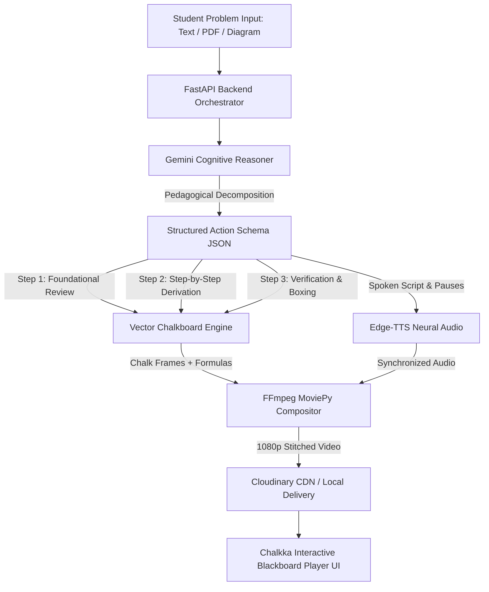

# Chalkka (Team Exception)
> **Turn Any Complex Idea into an Animated Chalkboard Lesson.**  
> Autonomous prerequisite diagnosis, vector-rendered chalk derivations, and synchronized classroom voice narration in under 15 seconds.

[](https://nextjs.org/)
[](https://fastapi.tiangolo.com/)
[](https://deepmind.google/technologies/gemini/)
[](https://www.typescriptlang.org/)
[](https://tailwindcss.com/)
[](https://opensource.org/licenses/MIT)

---

## Overview

When students get stuck solving complex problems in electrical circuits, advanced calculus, physics, or quantitative economics, traditional digital learning fails them:
1. **Generic LLM Chatbots**: Return massive walls of static text and unformatted math formulas without spatial reasoning or diagrams.
2. **Video Platforms (YouTube)**: Require scrubbing through 30-to-40-minute generic recordings that never address the student's exact homework boundary conditions.
3. **The Prerequisite Paradox**: 82% of students get stuck not on the current concept, but on an unremembered foundational theorem from semesters ago.

**Chalkka** bridges this chasm. Drop in a textbook diagram, problem sheet PDF, or natural language query. In under 15 seconds, Chalkka:
- **Diagnoses Foundational Gaps**: Traces problem lineage and reviews the missing theorem first.
- **Draws Vector Chalk Derivations**: Procedural blackboard engine renders LaTeX formulas, circuit diagrams, and force vectors stroke-by-stroke.
- **Speaks with Teacher Cadence**: Synchronizes neural voice narration with deliberate pedagogical pauses (`1.2s`) so concepts sink in.

---

## System Architecture



---

## Core Features

- **Automated Discipline Classifier**: Instantly recognizes Electrical Engineering, Mathematics, Physics, Chemistry, Computer Science, and Quantitative Economics without manual tags.
- **Vector Chalkboard Compositor**: Authentic procedural chalk-dust jitter, handwritten KaTeX equations, circuit schematics, and teacher callout circles/boxes.
- **Dual-Mode Interactive Player**: Watch the full synthesized 1080p MP4 or inspect the derivation stroke-by-stroke with interactive derivation scrubbers.
- **Credit & Job Management**: Built-in SQLite/Supabase job tracking and session state with 50 free starter credits.
- **Tactile Chalkboard UI**: Monochrome off-white aesthetic (`#FAFAFA`) with soft-grain canvas texture, kinetic interactive grid, and custom chalk cursor.

---

## Repository Structure

```text
Chalkka/
├── app/                      # Next.js 15 App Router frontend
│   ├── dashboard/            # Chalkboard Studio & Lesson History
│   ├── globals.css           # Soft grain overlay, design tokens & chalk cursor
│   ├── layout.tsx            # Root layout & providers
│   └── page.tsx              # Landing page & interactive demo
├── backend/                  # FastAPI Python backend engine
│   ├── app/
│   │   ├── api/              # Video generation, status & auth routers
│   │   ├── core/             # Pydantic schemas (LessonPlan, ChalkAction)
│   │   ├── services/
│   │   │   ├── ai/           # Gemini structured reasoning orchestrator
│   │   │   ├── audio/        # Edge-TTS voice synthesis engine
│   │   │   ├── storage/      # Cloudinary & local storage providers
│   │   │   └── video/        # Chalkboard renderer, math & schematic engines
│   │   └── worker/           # In-memory async generation queue
│   ├── Dockerfile            # Production container configuration
│   └── requirements.txt      # Python dependencies
├── components/               # React UI component library
│   ├── hero-chalkboard.tsx   # Hero section with interactive kinetic canvas
│   ├── interactive-demo.tsx  # Interactive chalkboard derivation player
│   └── ui/kinetic-grid.tsx   # Interactive physics-based canvas background
├── public/                   # Static assets & demo MP4 recordings
├── PITCH_DECK.md             # Complete 10-slide pitch deck blueprint
├── render.yaml               # Zero-friction Render blueprint
└── next.config.mjs           # Dynamic backend proxying & rewrites
```

---

## Getting Started Locally

### Prerequisites
- **Node.js**: v18+ (v20+ recommended)
- **Python**: 3.10+ (with `ffmpeg` installed or accessible)
- **Google Gemini API Key**: [Google AI Studio](https://aistudio.google.com/)

### 1. Frontend Setup
```bash
# Clone the repository
git clone https://github.com/baqx/Team-Exception.git
cd Team-Exception

# Install dependencies
npm install

# Configure environment
cp .env.example .env.local

# Start Next.js development server
npm run dev
```
Open [http://localhost:3000](http://localhost:3000) in your browser.

### 2. Backend Setup
```bash
cd backend

# Create and activate virtual environment
python -m venv .venv
source .venv/bin/activate    # On Windows: .venv\Scripts\activate

# Install dependencies
pip install -r requirements.txt

# Start FastAPI server
uvicorn app.main:app --reload --port 8000
```
Backend API docs available at [http://localhost:8000/docs](http://localhost:8000/docs).

---

## Deployment Guide

### Frontend on Vercel
1. Import this repository into [Vercel](https://vercel.com).
2. Configure Environment Variables:
   - `NEXT_PUBLIC_API_URL`: Your deployed Render backend URL (e.g. `https://chalkka-backend.onrender.com`).
   - `BACKEND_URL`: Same Render backend URL.
3. Deploy! Next.js rewrites in `next.config.mjs` will proxy requests seamlessly.

### Backend on Render
1. Create a new **Web Service** on [Render](https://render.com) from this repo (or use Blueprint with `render.yaml`).
2. Settings:
   - **Root Directory**: `backend`
   - **Build Command**: `pip install -r requirements.txt`
   - **Start Command**: `uvicorn app.main:app --host 0.0.0.0 --port $PORT`
3. Add Environment Variables:
   - `GOOGLE_GENERATIVE_AI_API_KEY`: Your Gemini API key.
   - `STORAGE_PROVIDER`: `cloudinary` (or `local`).
   - `CLOUDINARY_CLOUD_NAME`, `CLOUDINARY_API_KEY`, `CLOUDINARY_API_SECRET`.
   - `FRONTEND_URL`: Your Vercel frontend URL.

---

## License

This project is open-source under the [MIT License](LICENSE).
